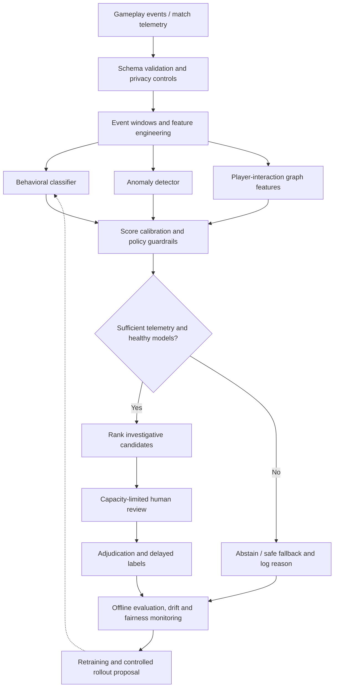

# Proposed Anti-Cheat ML Architecture

> **Design proposal, not a deployed system.** The notebooks simulate selected modeling and operational decisions; they do not implement the full diagram.

## Proposed data and inference path

1. **Ingest and validate:** match and player event streams require event-time ordering, schema checks, privacy minimization, deduplication, and late-event handling. These are design requirements, not features proven by this repository.
2. **Build features:** compute rolling reaction-time distributions, timing regularity, target accuracy and repeated-action signals; partition by match/time and avoid using post-decision information. Graph features may summarize co-play links, recency and clustering.
3. **Score:** use a supervised baseline alongside anomaly signals. Compare models using time-based holdouts, PR-AUC, calibration, and review-budget precision. A combined score requires independent validation before adoption.
4. **Decision policy:** prioritize cases for review under a capacity budget; use reason codes and evidence provenance. Do not equate a risk score with guilt.
5. **Fail safely:** on missing required features, return `insufficient_telemetry`; on unavailable models, return `model_unavailable` and use a validated fallback or abstain. Normal gameplay continues.
6. **Monitor:** check input drift, label delay/selection bias, calibration, false positives by skill segment, review backlog, inference errors, and patch-related shifts. Investigate before retraining.
7. **Roll out cautiously:** proposed offline backtesting → shadow scoring → limited canary → A/B or staged evaluation, with rollback triggers and documented ownership. None of these release stages are demonstrated as deployed here.

## Latency and throughput caveats

The skill-parsing notebook reports **simulated/local scoring measurements** (P99 10.059 ms), not network, serialization, feature-store, queue, or end-to-end production latency. The real-time notebook performs **illustrative throughput and backlog calculations** using assumed traffic and worker capacity; it does not load-test a deployed streaming service. Real deployment would need representative hardware, concurrent traffic, feature freshness measurements, P95/P99 service SLOs, load shedding, and disaster recovery tests.

## Threats to validity and player trust

High-skill legitimate players may resemble scripted behavior; cheats adapt after detection; review labels are missing not at random; graph connections can reflect innocent teammates; patch changes may shift features. A safe system requires careful segment evaluation, independent labels, human adjudication, privacy and appeals, not just higher detection rates.
